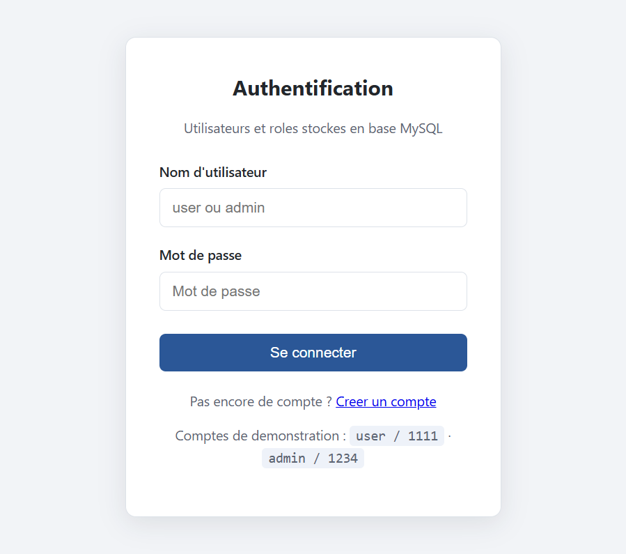
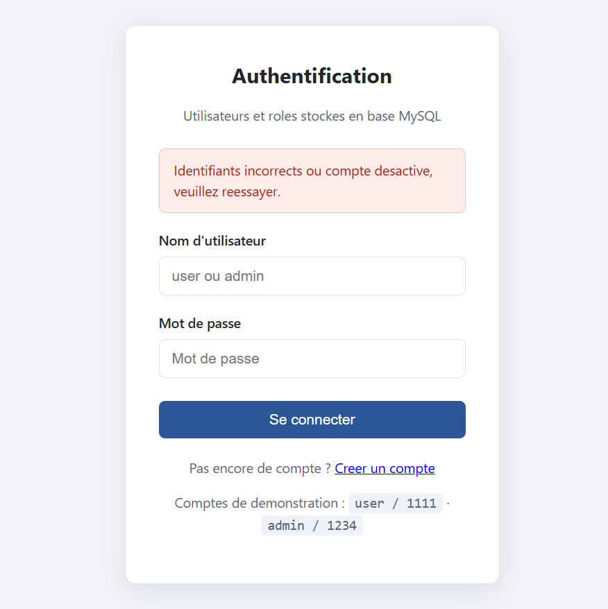
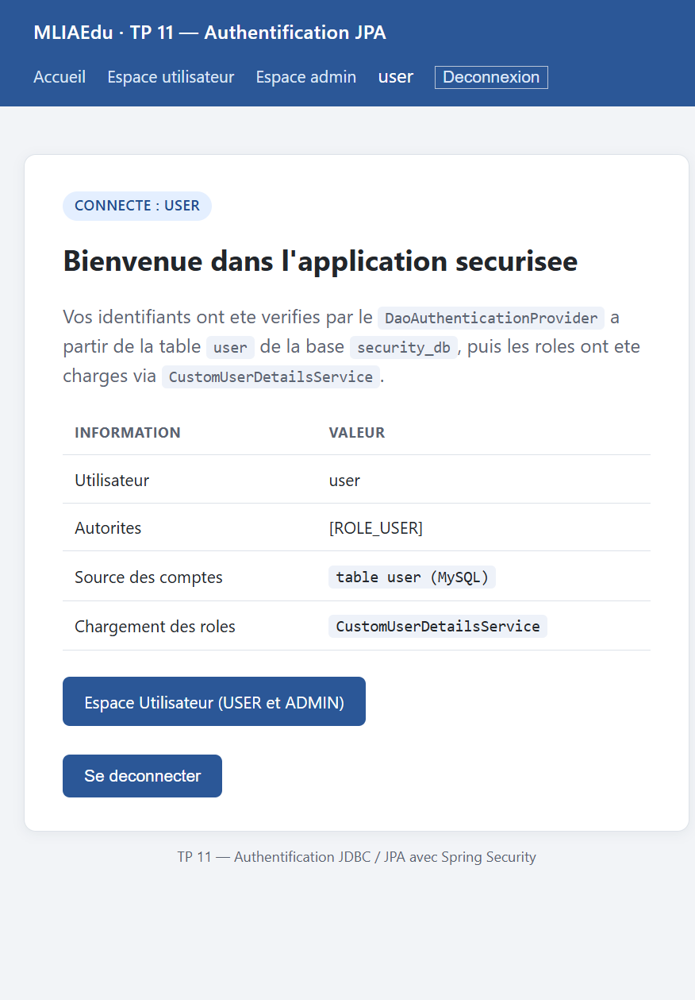
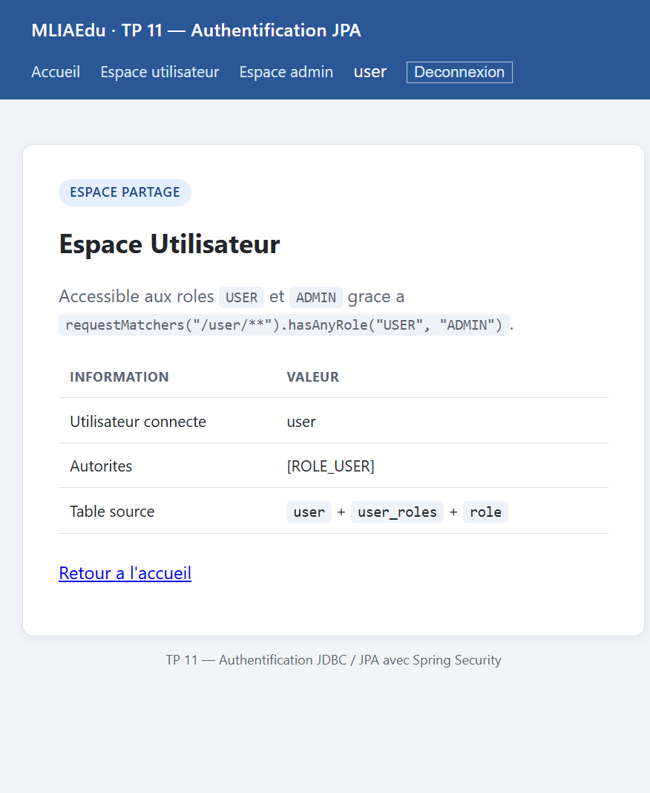
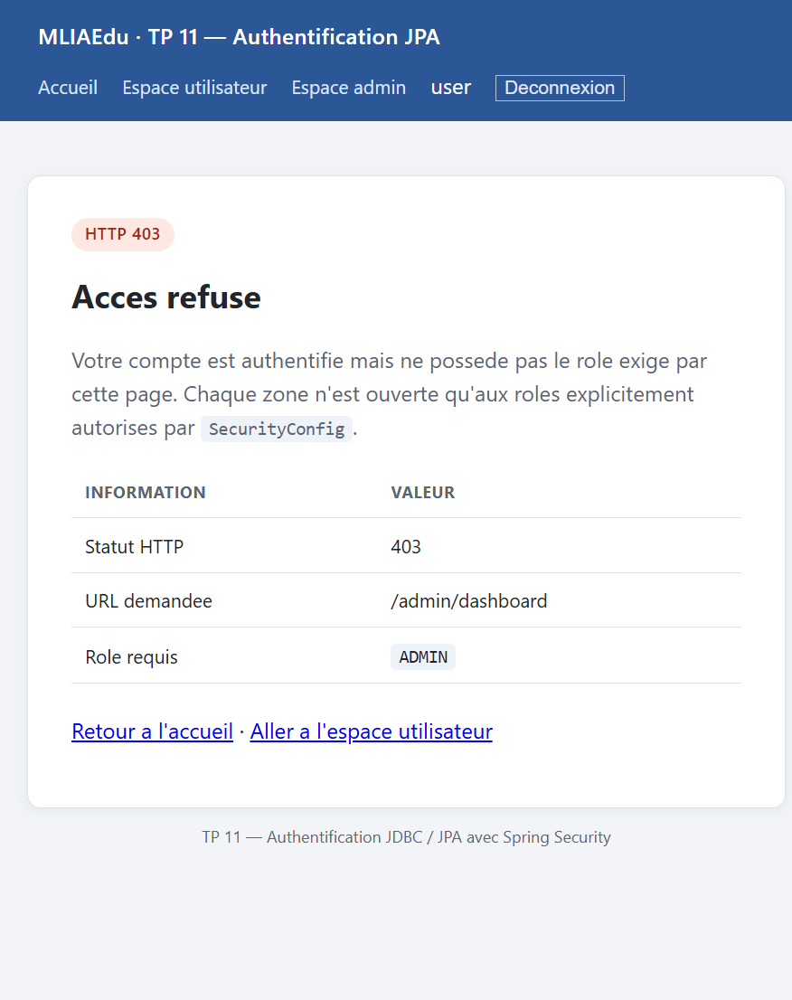
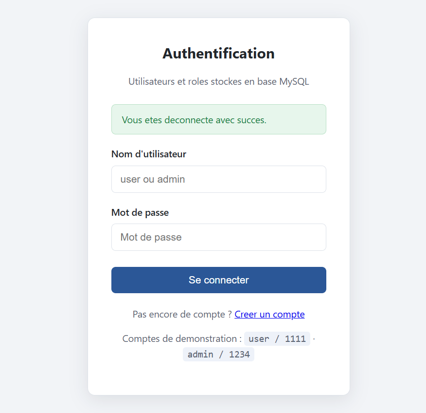
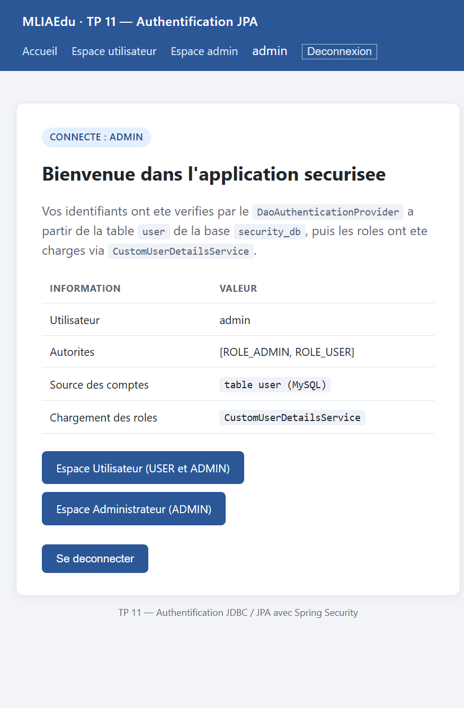
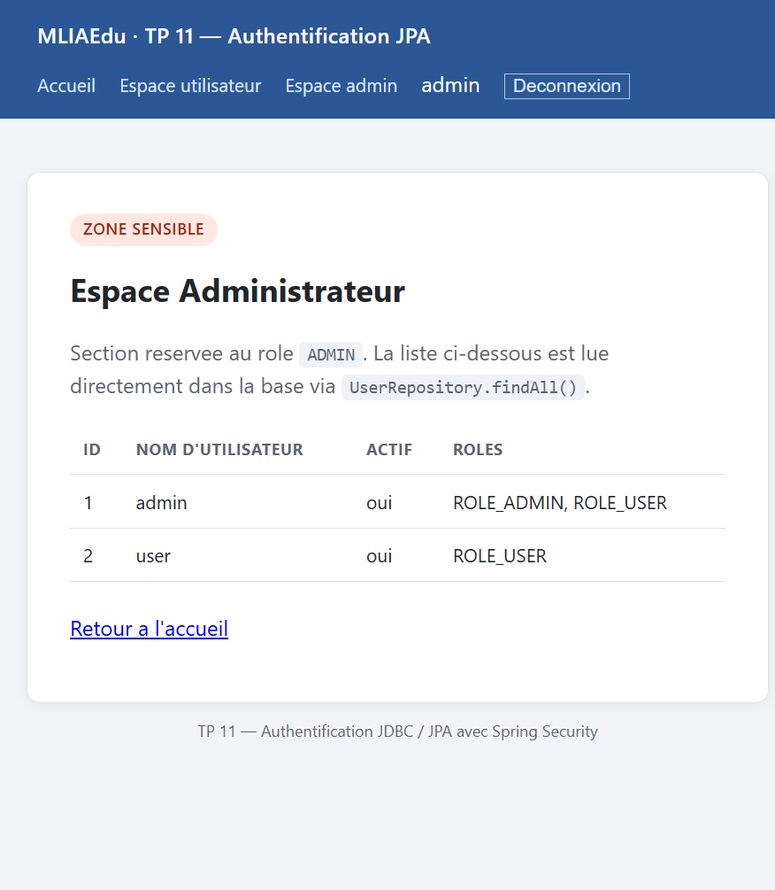

# TP 11 — Authentification JDBC / JPA avec Spring Security

Application Spring Boot / Thymeleaf qui **remplace l'authentification en mémoire** des TP précédents par une authentification **persistante en base MySQL**, grâce à Spring Data JPA, un `UserDetailsService` personnalisé et un hachage **BCrypt** des mots de passe.

> Cours : *Développement JakartaEE : Spring* — TP 11 (lab 210)
> Groupe Maven : `ma.fstg.security` · Artifact : `spring-security-jpa`

---

## 1. Objectifs

- Créer une base MySQL contenant des **utilisateurs** et des **rôles**.
- Configurer **Spring Data JPA** pour accéder à ces données.
- Utiliser un **`UserDetailsService` personnalisé** pour charger les utilisateurs depuis la base.
- Sécuriser les mots de passe avec **BCrypt**.
- Rendre l'authentification **persistante, réaliste et sécurisée**, comme en production.

---

## 2. Différence avec le TP précédent

| | TP 10 (en mémoire) | TP 11 (JPA) |
|---|---|---|
| Source des comptes | `InMemoryUserDetailsManager` | tables `user`, `role`, `user_roles` |
| Persistance | perdue à l'arrêt | conservée en base |
| Mots de passe | encodés au démarrage | hachés puis **stockés** en base |
| Création de compte | impossible | page `/register` |
| Chargement | `UserDetailsService` implicite | **`CustomUserDetailsService`** explicite |

---

## 3. Base de données

```sql
CREATE DATABASE security_db CHARACTER SET utf8mb4 COLLATE utf8mb4_unicode_ci;
```

`src/main/resources/application.properties` :

```properties
spring.datasource.url=jdbc:mysql://localhost:3306/security_db?useSSL=false&serverTimezone=UTC&allowPublicKeyRetrieval=true
spring.datasource.username=root
spring.datasource.password=
spring.jpa.hibernate.ddl-auto=update
spring.jpa.show-sql=true
spring.jpa.properties.hibernate.dialect=org.hibernate.dialect.MySQLDialect
```

- `ddl-auto=update` : Hibernate **crée** ou **met à jour** les tables à partir des entités.
- `show-sql=true` : les requêtes SQL sont affichées dans la console (suivi pédagogique).

### Schéma généré (`SHOW CREATE TABLE`)

```sql
CREATE TABLE `user` (
  `id` bigint(20) NOT NULL AUTO_INCREMENT,
  `active` bit(1) NOT NULL,
  `password` varchar(255) DEFAULT NULL,
  `username` varchar(255) DEFAULT NULL,
  PRIMARY KEY (`id`)
);

CREATE TABLE `role` (
  `id` bigint(20) NOT NULL AUTO_INCREMENT,
  `name` varchar(255) DEFAULT NULL,
  PRIMARY KEY (`id`)
);

CREATE TABLE `user_roles` (
  `user_id` bigint(20) NOT NULL,
  `role_id` bigint(20) NOT NULL,
  CONSTRAINT `FK55itppkw3i07do3h7qoclqd4k` FOREIGN KEY (`user_id`) REFERENCES `user` (`id`),
  CONSTRAINT `FKrhfovtciq1l558cw6udg0h0d3` FOREIGN KEY (`role_id`) REFERENCES `role` (`id`)
);
```

`user_roles` est la **table de jointure** de la relation `@ManyToMany` entre `User` et `Role`.

---

## 4. Modèle de données

```
+----------------+        +----------------+        +--------------+
|      role      |        |   user_roles   |        |     user     |
+----------------+        +----------------+        +--------------+
| id   (PK)      |<------>| role_id (FK)   |        | id       (PK)|
| name           |        | user_id (FK)   |<------>| username     |
+----------------+        +----------------+        | password     |
                                                    | active       |
                                                    +--------------+
```

- Un **utilisateur** possède **plusieurs rôles** (`@ManyToMany`).
- `fetch = FetchType.EAGER` : les rôles sont chargés **avec** l'utilisateur — indispensable car Spring Security lit les autorités juste après le chargement, hors session Hibernate.
- `active` permet de **désactiver** un compte sans le supprimer.

### Entités

| Classe | Rôle |
|---|---|
| [`Role`](src/main/java/ma/fstg/security/entities/Role.java) | `id`, `name` (`ROLE_ADMIN`, `ROLE_USER`) |
| [`User`](src/main/java/ma/fstg/security/entities/User.java) | `id`, `username`, `password`, `active`, `roles` |

### Repositories

| Interface | Méthodes |
|---|---|
| [`UserRepository`](src/main/java/ma/fstg/security/repositories/UserRepository.java) | `findByUsername` (Optional), `existsByUsername`, `findAll`, `save` |
| [`RoleRepository`](src/main/java/ma/fstg/security/repositories/RoleRepository.java) | `findByName`, `save` |

---

## 5. Chaîne d'authentification

```
Navigateur                Spring Security                       Base MySQL
    |                            |                                   |
    |  POST /login (user/1111)   |                                   |
    |--------------------------->|                                   |
    |                            |  DaoAuthenticationProvider        |
    |                            |  -> CustomUserDetailsService     |
    |                            |  -> UserRepository.findByUsername |
    |                            |---------------------------------->|
    |                            |      User + roles (EAGER)         |
    |                            |<----------------------------------|
    |                            |  BCrypt.matches(1111, hash)       |
    |  302 /home  + JSESSIONID   |                                   |
    |<---------------------------|                                   |
```

1. Le filtre `UsernamePasswordAuthenticationFilter` intercepte `POST /login`.
2. Le `DaoAuthenticationProvider` délègue le chargement au **`CustomUserDetailsService`**.
3. Le service lit la table `user`, transforme chaque `Role` en `SimpleGrantedAuthority`.
4. `BCryptPasswordEncoder.matches()` compare le mot de passe saisi au **hash** stocké.
5. En cas de succès, l'`Authentication` est placée dans le `SecurityContext` et la session.

### Extraits clés

[`CustomUserDetailsService`](src/main/java/ma/fstg/security/services/CustomUserDetailsService.java) :

```java
User user = userRepository.findByUsername(username)
        .orElseThrow(() -> new UsernameNotFoundException("Utilisateur non trouve : " + username));

return new org.springframework.security.core.userdetails.User(
        user.getUsername(), user.getPassword(), user.isActive(),
        true, true, true,
        user.getRoles().stream()
                .map(role -> new SimpleGrantedAuthority(role.getName()))
                .collect(Collectors.toList()));
```

[`SecurityConfig`](src/main/java/ma/fstg/security/config/SecurityConfig.java) :

```java
@Bean
public DaoAuthenticationProvider authenticationProvider() {
    DaoAuthenticationProvider provider = new DaoAuthenticationProvider();
    provider.setUserDetailsService(userDetailsService);
    provider.setPasswordEncoder(passwordEncoder());
    return provider;
}
```

---

## 6. Règles d'accès

| URL | Accès | Règle |
|---|---|---|
| `/login`, `/register`, `/css/**`, `/error` | public | `permitAll()` |
| `/user/**` | `USER` **ou** `ADMIN` | `hasAnyRole("USER","ADMIN")` |
| `/admin/**` | `ADMIN` uniquement | `hasRole("ADMIN")` |
| tout le reste | authentifié | `authenticated()` |

- `defaultSuccessUrl("/home", true)` : redirection **forcée** vers `/home` après connexion.
- `failureUrl("/login?error=true")` : message d'erreur dans la page de connexion.
- `logoutSuccessUrl("/login?logout=true")` + `deleteCookies("JSESSIONID")` : déconnexion propre.

---

## 7. Initialisation des données

[`DatabaseInitializer`](src/main/java/ma/fstg/security/config/DatabaseInitializer.java) est un `CommandLineRunner` exécuté au démarrage :

1. si la table `user` n'est pas vide → **on ne fait rien** (l'opération est *idempotente*, un redémarrage ne duplique pas les comptes) ;
2. sinon il crée `ROLE_ADMIN` / `ROLE_USER` puis les deux comptes de démonstration.

| Identifiant | Mot de passe | Rôles |
|---|---|---|
| `admin` | `1234` | `ROLE_ADMIN`, `ROLE_USER` |
| `user` | `1111` | `ROLE_USER` |

Contrairement au code du support (qui réinsérait les rôles à chaque démarrage), la version publiée vérifie `findByName` / `count()` au préalable : c'est le seul écart assumé, il évite les doublons en base.

---

## 8. Inscription (`/register`)

[`RegisterController`](src/main/java/ma/fstg/security/web/RegisterController.java) ajoute une inscription publique :

- validation : nom obligatoire, mot de passe ≥ 4 caractères, confirmation identique, nom non déjà pris ;
- le mot de passe est **haché en BCrypt** avant `save()` ;
- le compte est créé `active = true` avec le seul rôle `ROLE_USER` ;
- en cas d'erreur, le formulaire est réaffiché avec un message.

```
POST /register  username=yasmine&password=4321&confirmation=4321
  -> INSERT INTO user (username,password,active) VALUES ('yasmine','$2a$10$2Gi...',1)
  -> INSERT INTO user_roles (user_id,role_id) VALUES (3,2)
```

---

## 9. Écrans

| Connexion | Erreur d'identifiants |
|---|---|
|  |  |

| Accueil `user` | Espace utilisateur |
|---|---|
|  |  |

| `/admin/dashboard` refusé (403) | Déconnexion |
|---|---|
|  |  |

| Accueil `admin` | Espace admin (données issues de MySQL) |
|---|---|
|  |  |

| Inscription |
|---|
|  |

L'espace administrateur affiche la liste des comptes **lue en base** :

```
Id  Nom d'utilisateur  Actif  Roles
1   admin              oui    ROLE_ADMIN, ROLE_USER
2   user               oui    ROLE_USER
```

---

## 10. Vérification MySQL

```console
$ mysql -u root -D security_db -e "SELECT id,username,password,active FROM user;"
id  username  password                                                     active
1   admin     $2a$10$q9eaNQ6d8udLatzwZwNwguHPqE/3Gt.h.wesg0pOEkRcrALfKHvrC  1
2   user      $2a$10$6l.uxRfFTxWcunVRK6q3bOGWlLXIJAJY./7pGoObMQeafcYS9eB5W  1

$ mysql -u root -D security_db -e "SELECT * FROM user_roles;"
user_id  role_id
1        1
1        2
2        2

$ mysql -u root -D security_db -e "SELECT * FROM role;"
id  name
1   ROLE_ADMIN
2   ROLE_USER
```

Les mots de passe commencent bien par `$2a$` : **aucun mot de passe en clair** n'est stocké.
Sortie complète : [`docs/mysql-verification.txt`](docs/mysql-verification.txt).

---

## 11. Tests automatisés — 26 tests, tous verts

```console
$ mvn test
[INFO] Tests run: 5,  Failures: 0, Errors: 0, Skipped: 0 -- CustomUserDetailsServiceTest
[INFO] Tests run: 6,  Failures: 0, Errors: 0, Skipped: 0 -- RepositoryTest
[INFO] Tests run: 15, Failures: 0, Errors: 0, Skipped: 0 -- SecurityConfigTest
[INFO] Tests run: 26, Failures: 0, Errors: 0, Skipped: 0
[INFO] BUILD SUCCESS
```

### [`CustomUserDetailsServiceTest`](src/test/java/ma/fstg/security/CustomUserDetailsServiceTest.java) (5)

| Test | Vérifie |
|---|---|
| `loadsAdminWithBothRoles` | `admin` → `ROLE_ADMIN` + `ROLE_USER` |
| `loadsPlainUserWithSingleRole` | `user` → `ROLE_USER` seulement |
| `passwordIsBcryptHashed` | hash `$2…`, `matches("1234")` vrai / `matches("mauvais")` faux |
| `disabledAccountIsNotEnabled` | un compte `active=false` est chargé mais `isEnabled()` faux |
| `unknownUserThrows` | `UsernameNotFoundException` |

### [`RepositoryTest`](src/test/java/ma/fstg/security/RepositoryTest.java) (6)

| Test | Vérifie |
|---|---|
| `findByUsernameReturnsUser` | utilisateur trouvé + 2 rôles chargés (EAGER) |
| `findByUsernameUnknownIsEmpty` | `Optional.empty()` |
| `existsByUsername` | détection d'un nom déjà pris |
| `findByNameReturnsRole` | rôle `ROLE_ADMIN` retrouvé |
| `findByNameUnknownIsNull` | rôle absent → `null` |
| `rolesAreLinkedThroughJoinTable` | jointure `user_roles` correcte |

### [`SecurityConfigTest`](src/test/java/ma/fstg/security/SecurityConfigTest.java) (15)

| Test | Vérifie |
|---|---|
| `loginPageIsPublic` / `registerPageIsPublic` | pages publiques |
| `anonymousIsRedirectedToLogin` | anonyme → 302 `/login` |
| `userCanAuthenticate` / `adminCanAuthenticate` | `formLogin` contre la **base** |
| `wrongPasswordIsRejected` | → `/login?error=true` |
| `unknownUserIsRejected` | utilisateur inexistant refusé |
| `userCanReachUserSpace` | `USER` → `/user/dashboard` 200 |
| `userCannotReachAdminSpace` | `USER` → 403 |
| `adminCanReachAdminSpace` / `adminCanReachUserSpace` | `ADMIN` partout |
| `registerCreatesActiveUser` | compte actif + `ROLE_USER` + hash `$2` |
| `registerRejectsPasswordMismatch` / `registerRejectsExistingUsername` | validations |
| `logoutRedirectsWithMessage` | `/login?logout=true` |

> Les tests utilisent le profil `test` : base **H2 en mémoire** (`MODE=MySQL`, `NON_KEYWORDS=USER,ROLE`), donc `mvn test` fonctionne **sans MySQL démarré**.
> `@AutoConfigureTestDatabase(replace = NONE)` est nécessaire pour que `@DataJpaTest` n'impose pas sa propre base H2 par défaut, qui ne connaît ni la casse ni les mots réservés MySQL.

---

## 12. Lancer l'application

```bash
# 1. démarrer MySQL (XAMPP/WAMP) puis créer la base
mysql -u root -e "CREATE DATABASE IF NOT EXISTS security_db CHARACTER SET utf8mb4 COLLATE utf8mb4_unicode_ci;"

# 2. compiler + tester
mvn clean package

# 3. exécuter
mvn spring-boot:run
# ou
java -jar target/spring-security-jpa-1.0.0.jar
```

Puis <http://localhost:8080/login> :

| Compte | Accès |
|---|---|
| `user / 1111` | `/home`, `/user/dashboard` — **403** sur `/admin/dashboard` |
| `admin / 1234` | `/home`, `/user/dashboard`, `/admin/dashboard` |

---

## 13. Structure du projet

```
tp11-spring-jpa
├── pom.xml
├── docs/
│   ├── build.log
│   ├── tests.log
│   ├── mysql-verification.txt
│   └── images/01..09
└── src
    ├── main
    │   ├── java/ma/fstg/security
    │   │   ├── SpringSecurityJpaApplication.java
    │   │   ├── config/{SecurityConfig, DatabaseInitializer}.java
    │   │   ├── entities/{Role, User}.java
    │   │   ├── repositories/{UserRepository, RoleRepository}.java
    │   │   ├── services/CustomUserDetailsService.java
    │   │   └── web/{HomeController, RegisterController}.java
    │   └── resources
    │       ├── application.properties
    │       ├── static/css/style.css
    │       └── templates/{login, register, home, user-dashboard, admin-dashboard, error, fragments}.html
    └── test
        ├── java/ma/fstg/security/{SecurityConfigTest, CustomUserDetailsServiceTest, RepositoryTest}.java
        └── resources/application-test.properties
```

---

## 14. Points pédagogiques essentiels

- **Persistance** : les utilisateurs survivent au redémarrage, contrairement aux TP précédents.
- **Sécurité** : mots de passe hachés en BCrypt — le hash est *irréversible*, seule la comparaison est possible.
- **Découplage** : `DaoAuthenticationProvider` ne connaît que l'interface `UserDetailsService`, pas la base.
- **EAGER** : indispensable pour `@ManyToMany` sur les rôles, sinon `LazyInitializationException` pendant l'authentification.
- **Scalabilité** : cette architecture se prolonge naturellement vers l'inscription, les comptes désactivables, puis OAuth2 (TP 13).
- **`ROLE_`** : `hasRole("ADMIN")` ajoute automatiquement le préfixe ; la base doit donc stocker `ROLE_ADMIN`.

---

## 15. Pistes d'amélioration

- Paginer la liste des comptes de `/admin/dashboard`.
- Ajouter un écran de gestion des rôles (promouvoir un `USER` en `ADMIN`).
- Vérifier l'unicité de `username` par une contrainte `UNIQUE` en base, pas seulement côté contrôleur.
- Remplacer `ddl-auto=update` par **Flyway** ou **Liquibase** pour versionner le schéma.